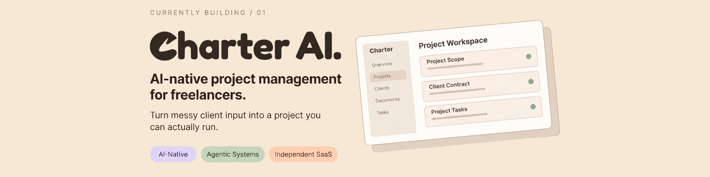

  

<h1 align="center">Manav Talan</h1>

  <strong>Applied AI Engineer / Web Experience Developer</strong>

  
  
  
  
  

## About Me

I'm an independent developer and product builder working at the intersection of **Artificial Intelligence, Software Engineering and Creative Design.**

I build AI-powered products, explore agentic systems and develop immersive web experiences. My approach is simple: identify problems, engineer solutions and turn them into meaningful products.

### What I'm focused on

AI agents, LLM applications and intelligent systems.

Full-stack development and scalable architectures.

3D, motion and interactive digital experiences.

Turning personal problems into useful software products.

## Currently Building

Building an **AI-native operating system for freelancers** that transforms unstructured client conversations, briefs and documents into structured, executable projects.

Charter AI is designed to bring the entire freelance project lifecycle into one intelligent platform — from initial client intake to project delivery.

### Core Capabilities in Development

- **Intelligent Client Intake** — Transform messy client inputs into structured project requirements.
- **AI-Powered Scope Generation** — Generate comprehensive and actionable project scopes.
- **Intelligent Contract Generation** — Convert approved project scopes into client-ready contracts.
- **Automated Project Planning** — Break projects into actionable tasks, milestones and deliverables.
- **Custom AI Orchestration** — Context-aware AI workflows, structured outputs and intelligent task execution.
- **Contextual Memory** — Maintain relevant project and client context across AI workflows.
- **Unified Project Workspace** — Manage clients, projects, documents and tasks in one place.
- **Human-in-the-Loop Approval** — AI proposes, humans approve and commit important decisions.

### Building With

**Frontend & Application**

**AI & Intelligence**

**Backend, Database & Infrastructure**

**Validation, Security & Testing**

 

  

